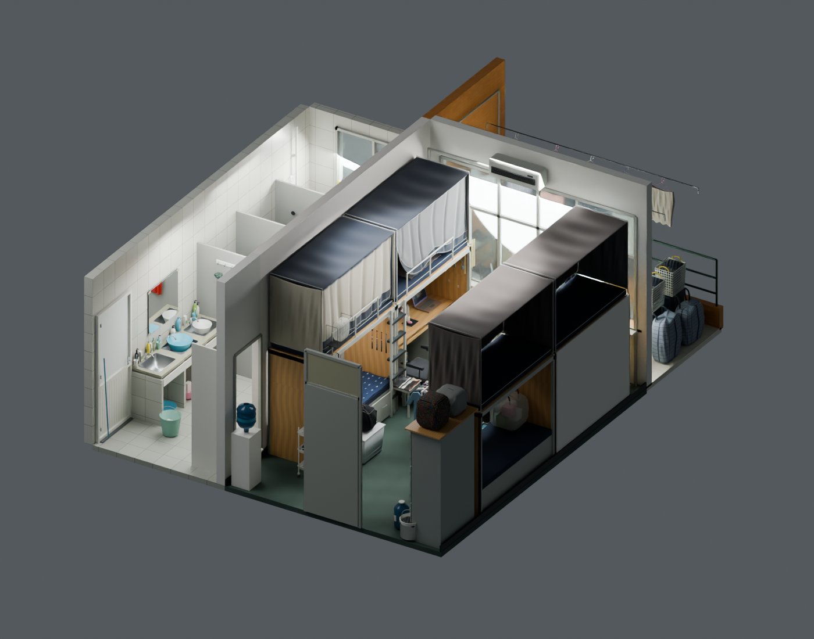

# 寝室模型 · Dorm Room Model

依据寝室照片制作的静态三维模型，包含床铺、书桌、阳台、卫浴与日常小物。尺寸来自照片估计，未经实测。

## 下载与查看

下载 [dorm-room.glb](https://github.com/xulianglong-akk/dorm-room-model/raw/refs/heads/main/dorm-room.glb)（约 75 MiB）。这是标准 glTF 2.0 二进制模型，材质、贴图全部内嵌，无需另外下载素材。

- **Blender**：`文件 → 导入 → glTF 2.0 (.glb/.gltf)`。滚轮缩放，中键旋转，Shift + 中键平移。Blender 5.2 会将多个场景合并到一个集合：可先在大纲视图隐藏 `Optional balcony exterior`，避免背景影响取景；隐藏 `Ceiling_Main`、`Bath_Ceiling`、`Balcony_Ceiling` 与 `Wall_Right` 可查看内部。
- 其他支持 GLB 的三维查看器：直接打开文件即可。默认场景为剖面总览，便于查看内部。

文件包含三个静态场景，共享同一份模型几何：

1. **Dorm / cutaway overview**：默认剖面模型，隐藏屋顶和部分外墙。
2. **Dorm / complete model**：完整寝室。
3. **Dorm / balcony exterior**：完整寝室与可选窗外照片背景。

窗外背景根据本人拍摄的照片清理前景遮挡、拼接并补绘，作为远景贴图使用；不是精确的周边建筑模型。单纯查看寝室时选择第一场景，避免远景背景影响自动取景。

模型较大，首次载入可能需要等待。不同查看器对玻璃、布料和光照的处理会有差异。

## 范围与许可

本仓库仅包含模型、预览图和查看说明，没有个人网站、第一人称行走程序、账号数据或原始寝室照片。公开版将照片中的角色贴纸、挂件照片和部分印花换为普通材质，保留对应几何。

模型与预览图按 [CC BY 4.0](https://creativecommons.org/licenses/by/4.0/) 许可分享。使用或修改时请署名 `xulianglong-akk`，附本仓库链接与许可证链接，说明所作修改。商标及现实物品外形不构成对相应品牌或第三方权利的授权。
